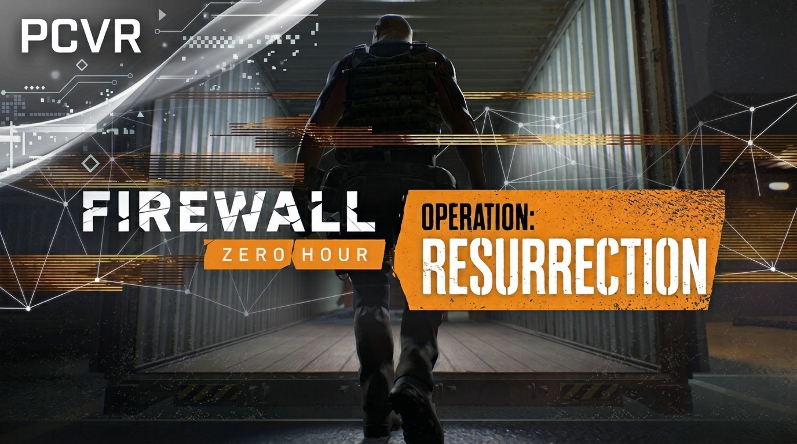

<p align="center">
  
</p>

# FZH Resurrection

**Firewall Zero Hour (PS4, CUSA11182 v1.43) running on a PC VR headset, with online multiplayer
on a community server or one you host yourself.**

The emulator is a modified [shadPS4](https://github.com/shadps4-emu/shadPS4), built from the
[Farpoint PC VR fork](https://github.com/evertec82/Farpoint), that renders to the headset through
OpenXR. A Windows launcher handles game setup, accounts, friends and updates. The server
(shadNet, a progression backend and a P2P relay) can be hosted by anyone.

> **No game files are included.** Each player needs their own legally obtained dump of the game.
> This project is not affiliated with or endorsed by First Contact Entertainment or Sony
> Interactive Entertainment. Firewall Zero Hour, PlayStation and PlayStation VR are trademarks of
> their respective owners, named only to identify the game this software runs. All other
> trademarks and copyrights belong to their respective owners.

<p align="center">
  <a href="#help-wanted-servers-and-relays">Help wanted</a> ·
  <a href="#status">Status</a> ·
  <a href="#what-you-need">What you need</a> ·
  <a href="#quick-start">Quick start</a> ·
  <a href="#online">Online</a> ·
  <a href="#hosting-a-server">Hosting a server</a> ·
  <a href="#building-from-source">Building from source</a> ·
  <a href="#repository-layout">Repository layout</a> ·
  <a href="#credits-and-licence">Credits</a>
</p>

## Help wanted: servers and relays

The community server runs on a small free VPS in Stockholm, with one additional relay in Singapore. When two players cannot connect directly their traffic goes through a relay, and the relay's distance from them becomes their latency. Relays in other regions are what is missing, North America first, then South America and Oceania. Running one is lightweight: a single Python script (`server/relay/relay.py`, standard library only), one inbound UDP port (31316 by default), a few megabytes of memory and nothing stored on disk. The emulator registers with every listed relay and two players use the one with the shortest round trip.

To add a relay:

1. Start `relay.py` on your machine and open the UDP port inbound. See [docs/self-hosting.md](docs/self-hosting.md#hosting-only-a-relay) for details.
2. Check it with `python tools/check-relays.py host:port`.
3. Add an entry to `server/relay/relays.json` and open a pull request.

The list is compiled into the launcher at release time, so a new relay reaches players with the next release. Up to 8 relays ship per release; the maintainers pick from the list, aiming for one or two per region. If you can offer a whole server rather than a relay, please reach out through [Issues](https://github.com/lilium360/FZH-Resurrection/issues) or [Discussions](https://github.com/lilium360/FZH-Resurrection/discussions).

## Status

This is an early release. Only the European release (CUSA11182) with update 1.43 is supported.
The launcher rejects the USA release (CUSA09831) and other update versions.

## What you need

- Your own, legally obtained dump of Firewall Zero Hour: the base game (CUSA11182) and update
  1.43, as PKG files or an extracted folder. When installing from PKG files the launcher extracts
  the game, which takes about 40.1 GB of disk space.
- A PC VR headset with an OpenXR runtime. The game is played with the Aim controller (emulated on
  the right VR controller) or with a DualShock 4.
- 64-bit Windows.

## Quick start

1. Download the installer from
   [Releases](https://github.com/lilium360/FZH-Resurrection/releases) and run it. No
   administrator rights are needed.
2. The setup assistant asks for your game folder. If you have PKG files, the launcher extracts
   them (about 40.1 GB). Your dump is never modified: the launcher keeps its own files in its
   data folder.
3. Create your account: choose a user name (Online ID) and save the recovery code the launcher
   shows. The code is shown once and cannot be recovered.
4. Play. On the first launch Windows may ask whether the emulator can use networks: choose Allow,
   at least for private networks, so other players can connect to you directly.

The launcher checks for updates when it starts and from About > Check for updates, and installs
them itself. An optional shader warm-up pre-compiles shaders by letting the game play solo
training matches in a window on the monitor, taking 12 to 46 minutes.

## Online

- **Accounts.** You choose a user name (Online ID) and nothing else: no email, no password. The
  launcher shows a recovery code once. That code is the only way to sign in on another PC or after
  reinstalling. It cannot be shown again, reset or changed, and the server never sees it.
- **Friends.** Add friends and accept or decline requests in the launcher, by Online ID.
- **Matches.** Public matchmaking and private lobbies run on the server. Invitations to a private
  lobby are sent from the game to friends and answered inside the headset.
- **Connections.** Matches run directly between players. When players cannot reach each other,
  their traffic goes through a relay on the server.

Accounts belong to the server they were created on. To play on a different server, turn on
"Use a private server" in the launcher's Advanced screen and enter the address.

## Hosting a server

A server runs three services: shadNet (the PlayStation Network replacement, handling accounts,
friends and lobbies), a progression backend (player data, avatars, account registration) and a P2P
relay. Anyone can run one, on Linux with Docker or as plain processes. A group of friends needs
little more than one CPU core and 1 GB of memory.
See [docs/self-hosting.md](docs/self-hosting.md).

## Building from source

Requirements and instructions are in [docs/building.md](docs/building.md) and
[emulator/README.md](emulator/README.md). In short: Visual Studio 2022 or later with the C++
tools, LLVM 19 or later, Node.js 20 or later and Rust.

```
git clone --recurse-submodules https://github.com/lilium360/FZH-Resurrection
cd FZH-Resurrection
powershell -ExecutionPolicy Bypass -File emulator\build.ps1 -LlvmDir C:\path\to\LLVM
cd launcher
npm ci
npm run tauri build -- --config "{\"bundle\":{\"createUpdaterArtifacts\":false}}"
```

The installer ends up in `launcher/src-tauri/target/release/bundle/nsis/`. A build without
`FZH_DEFAULT_SERVER` defaults to `127.0.0.1`;
[docs/building.md](docs/building.md) explains how to set a different server, and
[docs/testing.md](docs/testing.md) how to run one locally. The update signature and key are
described in [docs/releasing.md](docs/releasing.md).

## Repository layout

| Folder | Contents |
|---|---|
| `emulator/` | Modified shadPS4: OpenXR rendering, the shadNet network stack, peer-to-peer play with relay fallback, the in-headset invitation banner |
| `launcher/` | Windows launcher (Tauri 2, TypeScript and Rust): game installation and setup, settings, accounts, friends, mods, updates |
| `server/` | shadNet build recipe, progression backend, relay, account tool, Docker and bare-metal set-ups |
| `patches/` | Emulator patches for the game executable (update 1.43) |
| `tools/` | Test scripts, scripted inputs, mod file reference implementation |
| `docs/` | [Building](docs/building.md), [self-hosting](docs/self-hosting.md), [testing](docs/testing.md), [releasing](docs/releasing.md), [launcher contract](docs/launcher-contract.md) |

## Credits and licence

The emulator is based on [shadPS4](https://github.com/shadps4-emu/shadPS4), through the
[Farpoint PC VR fork](https://github.com/evertec82/Farpoint) (itself derived from AstroQuest and
shadps4-arm64). Online play uses [shadNet](https://github.com/shadps4-emu/shadNet), built
unmodified by `server/shadnet/`.

FZH Resurrection is licensed under the GNU General Public License, version 2 or (at your option)
any later version ([LICENSE](LICENSE)). Components and their licences are listed in
[THIRD-PARTY-NOTICES.md](THIRD-PARTY-NOTICES.md).
